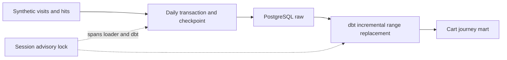

# Clickstream journeys with PostgreSQL and dbt

Reconstruct first/last cart-entry sources and orders within visits, using synthetic visits and hits. Range reloads replace whole days; checkpoints allow resuming after committed chunks.

## Result without running the code
The synthetic source includes four journeys per day. Each visit becomes one mart row:

| Input events (ordered by seq, then hit ID) | First cart source | Last cart source | Cart entries | Orders |
|---|---|---|---:|---:|
| page_view | null | null | 0 | 0 |
| cart(product), cart(search), order | product | search | 2 | 1 |
| cart(email), order, order | email | email | 1 | 2 |
| cart(product), cart(search), both seq=1 | product | search | 2 | 0 |

Three days produce **12 visits and 9 orders**. Reloading the first day with zero visits leaves eight mart rows, preserving the other two days. This lets an analyst inspect cart-entry paths without confusing an absent cart with an absent visit.

## Run
Docker and Python 3.12 recommended.
```sh
make install
make demo
make test
```
The tests use only the disposable demo database and reset its raw/reporting schemas. Do not point them at an existing database. Local connection defaults use port 15432 and demo credentials.

## Architecture


The incremental model replaces the selected date range, including deleted source visits. Other dates are preserved. A session advisory lock prevents overlapping runs and is released on connection loss. A dbt coverage test catches missing or extra mart visits.

## Recovery example
```sh
.venv/bin/python pipeline.py --batch recovery-demo --fail-after 1
# Intentional nonzero exit after committing the first day.
.venv/bin/python pipeline.py --batch recovery-demo --resume
```
Resume validates the stored date range, generator version and visit count for the batch; a new source revision should use a new batch without --resume. [Design notes](docs/architecture.md).

## Boundaries
Synthetic fixture adapter only; no real Logs API, dashboard, cloud scheduler or Telegram delivery. Unlike the separate ClickHouse release demo, dbt tests run after materialisation here: failure signals a bad result, not an atomic publication gate. Raw and reporting data are not switched atomically. No client code/data is included. MIT licence.

## Inspect and clean up
```sh
docker compose exec -T postgres psql -U demo -d demo -c 'SELECT * FROM reporting.cart_journey ORDER BY visit_id LIMIT 4;'
make down
```
`make down` deletes the disposable database volume. Tests cover no cart, multiple orders, tied sequence ordering, empty-day replacement, changed/unknown resume parameters and concurrent writers.

## Adaptation
I would replace the synthetic adapter with validated source batches and include a source revision fingerprint in the batch contract, then connect a scheduler and dashboard. The current generator version is a local fixture identity, not a hash of an external source.

[CI checks](https://github.com/zoercalm/clickstream-dbt-postgres/actions/workflows/ci.yml)
