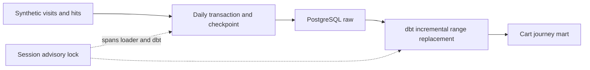

# Clickstream journeys with PostgreSQL and dbt

Reconstruct first/last cart-entry sources and orders within visits, using synthetic visits and hits. Range reloads replace whole days; checkpoints allow resuming after committed chunks.

## Run
Docker and Python 3.12 recommended.
```sh
make install
make demo
make test
```
The tests use only the disposable demo database and reset its raw/reporting schemas. Do not point them at an existing database. Local connection defaults use port 15432 and demo credentials.

## Architecture


The incremental model replaces the selected date range, including deleted source visits. Other dates are preserved. A session advisory lock prevents overlapping runs and is released on connection loss. A dbt coverage test catches missing or extra mart visits.

## Recovery example
```sh
.venv/bin/python pipeline.py --batch recovery-demo --fail-after 1
# Intentional nonzero exit after committing the first day.
.venv/bin/python pipeline.py --batch recovery-demo --resume
```
Resume requires the same source parameters and batch identifier; a new source revision should use a new batch without --resume. [Design notes](docs/architecture.md).

## Boundaries
Synthetic fixture adapter only; no real Logs API, dashboard, cloud scheduler or Telegram delivery. Unlike the separate ClickHouse release demo, dbt tests run after materialisation here: failure signals a bad result, not an atomic publication gate. Raw and reporting data are not switched atomically. No client code/data is included. MIT licence.
